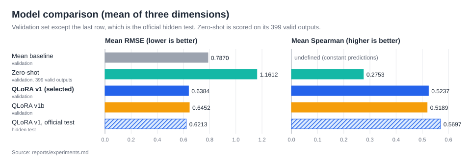
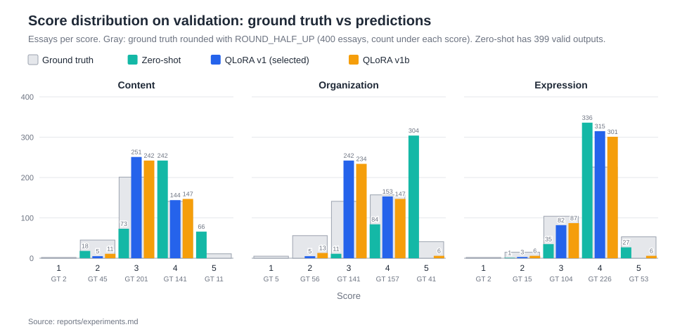
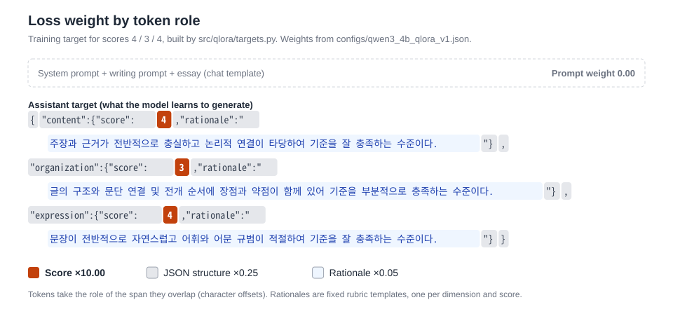
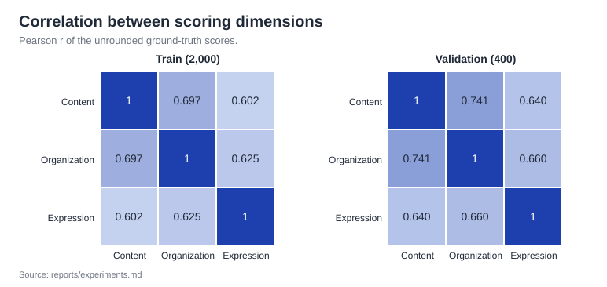

# Qwen3-4B + QLoRA 한국어 논증문 자동 채점

[English README](README.md)

2026 국립국어원 AI말평 글쓰기 채점 능력 평가에 참가하면서 만든 프로젝트입니다. 글쓰기 주제와 논증문을 넣으면 내용, 구성, 표현을 각각 1–5점으로 채점하고, 점수마다 한국어로 짧은 근거를 붙입니다.

Qwen3-4B-Instruct를 QLoRA로 파인튜닝했고, loss는 점수 토큰에 가중치를 크게 주도록 바꿨습니다. 비공개 공식 test set에서는 RMSE 0.621, Spearman 0.570이 나왔습니다.

- Base model: `Qwen/Qwen3-4B-Instruct-2507`
- Fine-tuning: 4-bit NF4 QLoRA
- Hugging Face: https://huggingface.co/slvrfivo/qwen3-4b-writing-eval-v1-merged

## 결과

| 모델 / 평가 | RMSE ↓ | Spearman ↑ | 비고 |
|---|---:|---:|---|
| 통계 평균 baseline | 0.7870 | 정의 안 됨* | 반올림하면 모든 글에 같은 점수 |
| Qwen3-4B zero-shot | 1.1612 | 0.2753 | 올바른 출력 399건으로 계산† |
| **Weighted QLoRA v1** | 0.6384 | 0.5237 | 최종 선택 |
| Class-balanced QLoRA v1b | 0.6452 | 0.5189 | ablation, 채택 안 함 |
| 공식 hidden test (v1) | 0.6213 | 0.5697 | LLM Judge 3.0337 |

\*평균 baseline은 공식 반올림을 거치면 모든 글에 같은 점수를 주게 돼서 Spearman을 계산할 수 없습니다.
†zero-shot 출력 1건이 올바른 JSON이 아니어서 zero-shot 지표에서 뺐습니다. 나머지 validation 행은 400건 전체로 계산했기 때문에, zero-shot 행은 완전히 같은 집합에서 비교한 값은 아닙니다.

예선 이후에는 전문가가 모델 출력을 직접 비교하는 AI말평 Arena 단계에도 참가했습니다.

공식 test RMSE(0.621)가 validation(0.638)보다 조금 좋게 나왔지만, split과 평가 조건이 달라서 큰 의미를 두지는 않았습니다.

최종 결과: [reports/final_results.md](reports/final_results.md) · 실험 기록: [reports/experiments.md](reports/experiments.md)

## 출력 형식

세 영역의 점수와 근거를 JSON 하나로 출력합니다.

~~~json
{
  "content": {
    "score": 4,
    "rationale": "주장과 근거가 주제에 맞게 제시되어 있으나 일부 근거의 구체성이 부족하다."
  },
  "organization": {
    "score": 3,
    "rationale": "전체적인 구조는 갖추고 있지만 문단 간 연결이 다소 자연스럽지 않다."
  },
  "expression": {
    "score": 4,
    "rationale": "대체로 적절한 어휘와 문장을 사용했으나 일부 표현이 반복된다."
  }
}
~~~

## 진행 과정

### 1. 공식 채점 방식 재현

모델을 학습하기 전에 `src/evaluate.py`를 먼저 만들어서, 로컬 점수를 대회 점수와 같은 기준으로 비교할 수 있게 했습니다.

- JSON 구조와 점수 범위(1–5) 확인
- `ROUND_HALF_UP`으로 반올림한 뒤 채점
- 내용, 구성, 표현별 RMSE와 Spearman 계산
- 동점은 평균 순위로 처리

### 2. Zero-shot baseline

`Qwen/Qwen3-4B-Instruct-2507`을 NF4 4-bit로 불러와 공식 prompt와 greedy decoding으로 추론했습니다. RMSE 1.161, Spearman 0.275가 나왔고, 400건 중 399건이 올바른 JSON이었습니다.

점수를 전반적으로 너무 높게 줬습니다. 특히 구성은 399건 중 304건에 5점을 줘서 파인튜닝을 하기로 했습니다.

### 3. QLoRA 파인튜닝

학습 환경이 VRAM 약 9.5 GiB짜리 A100 MIG여서 full fine-tuning은 할 수 없었고 QLoRA를 썼습니다. 최종 run의 설정은 다음과 같습니다.

- NF4 4-bit base model, BF16 compute
- 모든 linear layer에 LoRA, `r=16`, `alpha=32`, `dropout=0.05`
- 1 epoch, learning rate `5e-5`, effective batch size 8
- max sequence length 2048

전체 설정: [configs/qwen3_4b_qlora_v1.json](configs/qwen3_4b_qlora_v1.json)

### 점수 예측 분포

회색 막대는 예측과 같은 방식으로 반올림한 정답입니다. zero-shot은 세 영역 모두 점수를 높게 줬고, 구성 점수에서 특히 심했습니다(399건 중 304건이 5점, 정답은 41건). 파인튜닝 후에는 예측이 대부분 3점과 4점으로 옮겨 갔습니다(구성: 400건 중 242건, 153건). 점수를 높게 주던 문제는 거의 사라졌지만, 이번에는 예측이 정답보다 좁게 몰렸습니다. v1은 1점과 5점을 한 번도 예측하지 않았고 2점도 영역마다 3–5건뿐인데, 정답에는 내용·구성에 2점이 45–56건, 구성·표현에 5점이 41–53건 있습니다. v1b에서 늘어난 예측은 2점 몇 건과 영역마다 최대 6건의 5점뿐입니다.

## 토큰 역할별 loss 가중치

RMSE와 Spearman은 예측한 점수로 계산되기 때문에, 근거 설명보다 점수 토큰에 더 높은 loss 가중치를 줬습니다. 정답 토큰마다 역할을 붙이고, 역할별 가중치는 아래와 같이 정했습니다.

| 토큰 역할 | Loss weight |
|---|---:|
| Prompt | 0.00 |
| JSON 구조 | 0.25 |
| 점수 | 10.00 |
| 근거(rationale) | 0.05 |

점수가 4 / 3 / 4인 글의 실제 학습 정답을 `src/qlora/targets.py`로 만든 그림입니다. 토큰은 자기가 걸친 문자 구간의 역할을 따릅니다. 학습 정답의 근거 문장은 위 출력 예시처럼 자유롭게 쓴 문장이 아니라, 영역과 점수마다 하나씩 정해 둔 루브릭 문장입니다.

~~~text
weighted loss = Σ(token loss × token weight) / Σ(token weight)
~~~

이 합은 micro-batch 하나 안에서 계산됩니다. 기록된 학습은 `per_device_train_batch_size=1`, gradient accumulation 8이었기 때문에, 실제로는 글 한 편마다 자기 가중치 합으로 나눈 뒤 8편을 평균한 셈입니다. 같은 글 안의 토큰끼리 가중치를 다르게 주는 건 의도대로 작동하지만, 글 하나의 점수 토큰 전체를 올리는 가중치는 분모도 같이 커져서 효과가 상당 부분 상쇄됩니다 (아래 ablation 참고).

config의 `loss_normalization`(또는 명령행 `--loss-normalization`)으로 방식을 고를 수 있습니다.

- `per_sample` (기본값, v1·v1b에서 사용): 글마다 자기 가중치 합으로 나눔
- `dataset_mean`: 모든 글을 같은 상수(학습 데이터의 평균 가중치 합)로 나눠서, 글 단위 가중치가 그대로 반영됨

가중치는 탐색 없이 직접 정한 값입니다.

- `src/qlora/tokenization.py`: 토큰에 역할 붙이기
- `src/qlora/loss.py`: 가중 cross entropy 계산
- `src/qlora/training.py`: Transformers Trainer에 loss 연결

가중치를 모두 1로 둔 QLoRA는 학습해 보지 않았습니다. 그래서 성능이 오른 게 가중치 덕분인지, 파인튜닝 자체 덕분인지는 나눠서 말할 수 없습니다.

## Ablation: 점수별 class 가중치

v1도 여전히 3점과 4점에 몰려 있어서, v1b에서는 train 데이터에 드문 점수일수록 점수 토큰 가중치를 더 주었습니다.

| 모델 | RMSE ↓ | Spearman ↑ |
|---|---:|---:|
| Weighted QLoRA v1 | 0.6384 | 0.5237 |
| Class-balanced QLoRA v1b | 0.6452 | 0.5189 |

v1b는 2점과 5점을 조금 더 예측했지만(1점은 여전히 없음) 두 지표 모두 조금 나빠져서 v1을 그대로 썼습니다.

v1b는 `per_sample` 정규화로 학습했습니다. 어떤 글의 점수 토큰에 class 가중치 2.0을 주면 그 글의 분모도 같이 커지기 때문에, loss에서 점수 토큰이 차지하는 비중은 2배보다 훨씬 적게 늘어납니다. 세 점수가 모두 드문 점수인 글에서 차이가 가장 큰데, 세 영역 점수는 서로 상관이 높아서 이런 글이 적지 않습니다. 그래서 v1b의 class 가중치는 숫자보다 약하게 들어갔고, 이 결과는 class balancing 자체보다는 이 약한 버전에 대한 결과에 가깝습니다. 의도한 가중치를 확인하려면 `--loss-normalization dataset_mean`으로 v1b를 다시 돌려 봐야 하는데, 아직 돌리지 않았습니다.

세 영역 점수의 상관은 r = 0.60–0.74라서, 한 영역에서 드문 점수를 받은 글은 다른 영역에서도 드문 점수를 받는 경우가 많습니다.

## 회고: 점수와 근거 사이

점수 토큰에 10.0, 근거 토큰에 0.05를 주고 근거 정답도 템플릿에 가깝게 만들다 보니, 근거 품질이 떨어졌을 가능성이 큽니다. 실험 기록에도 파인튜닝 후 근거가 눈에 띄게 단순해졌다고 적어 뒀습니다. LLM Judge 점수(3.03)도 이 설명과 맞긴 하지만, 원인을 따로 떼어 확인한 실험은 없습니다.

다시 한다면 이렇게 해 보겠습니다.

- 가중치 없는 baseline을 돌리고 근거 가중치를 여러 값으로 바꿔 보기
- class balancing을 `dataset_mean` 정규화로 다시 돌려 보기
- 실제 제출본(merged BF16, `repetition_penalty=1.05`)으로 validation을 다시 재기. 위 validation 수치는 4-bit base model에 adapter를 붙이고 repetition penalty 없이 잰 값임
- 근거 정답을 더 풍부하게 만들기
- 점수 예측과 근거 생성을 두 단계로 나누기 (첫 모델이 점수를 내고, 두 번째 모델이 그 점수를 보고 근거를 씀)
- 모델을 고를 때 RMSE, Spearman뿐 아니라 근거 품질 지표도 보기

## Export와 서빙

최종 adapter를 고정한 BF16 base model에 merge해서 단독 Hugging Face 모델로 export했습니다. export 스크립트는 merge → 다시 불러오기 → model/tokenizer 일치 확인 → strict JSON smoke test 순서로 돌아갑니다.

최종 제출 전에 테스트해 보니 merge한 모델이 일부 입력에서 같은 말을 반복했습니다. 그래서 공개한 모델의 `generation_config.json`에 `"repetition_penalty": 1.05`를 넣었습니다. 이 값은 [configs/submission_generation.json](configs/submission_generation.json)에 두었고, export CLI가 smoke test 전에 export된 설정에 자동으로 써 넣습니다.

최종 모델은 vLLM의 OpenAI 호환 서버로도 띄워서, 대회에서 요구한 health, model 목록, chat completions endpoint가 동작하는지 확인했습니다. Hugging Face 모델 카드 초안은 [docs/huggingface_model_card.md](docs/huggingface_model_card.md)에 있습니다.

## 재현

학습 환경과 자세한 재현 방법: [docs/reproducibility.md](docs/reproducibility.md)

~~~bash
pip install -r requirements-train-gpu.txt

# 최종 QLoRA 설정으로 학습
python src/train_qlora.py \
  --input data/raw/train.jsonl \
  --output-dir checkpoints/qwen3_4b_qlora_v1 \
  --config configs/qwen3_4b_qlora_v1.json

# adapter로 validation 추론 (--adapter를 빼면 zero-shot)
python src/infer.py \
  --input data/raw/validation.jsonl \
  --output-dir outputs/qlora_v1 \
  --adapter checkpoints/qwen3_4b_qlora_v1/final_adapter

# 채점
python src/evaluate.py \
  --predictions outputs/qlora_v1/predictions.jsonl \
  --require-rationale

# BF16 단독 모델로 merge
python src/export_merged_hf.py \
  --adapter checkpoints/qwen3_4b_qlora_v1/final_adapter \
  --output-dir /path/to/submission/qwen3-4b-writing-eval-v1-merged \
  --validation-input data/raw/validation.jsonl
~~~

## 테스트

pull request와 `master` push마다 GitHub Actions에서 CPU unit test 100개를 돌립니다.

~~~bash
python -m unittest discover -s tests -v
~~~

## 저장소 구성

~~~text
ai-writing-eval/
├── configs/        # zero-shot, QLoRA, 최종 서빙 설정
├── docs/           # 대회, 재현 관련 메모
├── prompts/        # 버전 관리한 공식 prompt
├── reports/        # 실험 기록, 공식 결과
├── src/
│   ├── llm/        # prompt, 파싱, 추론, export
│   └── qlora/      # QLoRA 데이터, 토큰화, loss, 학습
├── tests/
├── requirements*.txt
├── LICENSE
└── README.md
~~~

## 한계

- 학습 데이터가 2,000건뿐입니다.
- v1도 예측이 가운데로 몰리는 경향이 남아 있고, 1점과 5점은 3점, 4점보다 맞히기 어렵습니다.
- 가중치 없는 run이 없어서 loss 가중치만의 효과는 알 수 없습니다.
- 로컬 채점기는 RMSE와 Spearman만 재현하고, 공식 LLM Judge는 재현하지 않습니다.
- 대회 prompt, 분야, 채점 기준 밖에서는 테스트하지 않았습니다.

## 데이터와 라이선스

대회 데이터는 이 저장소에 넣지 않았습니다. 데이터, checkpoint, 생성 결과, 모델 weight는 `.gitignore`로 제외했습니다.

코드는 Apache License 2.0으로 공개합니다. 외부 모델, 대회 데이터, 공식 자료는 각각의 이용 조건을 따릅니다.

## 공식 자료

- 과제 소개: https://kli.korean.go.kr/benchmark/taskOrdtm/taskList.do?taskOrdtmId=205
- Arena 소개: https://kli.korean.go.kr/taskOrdtm/taskList.do?clCd=END_TASK&subMenuId=sub01&taskOrdtmId=215
