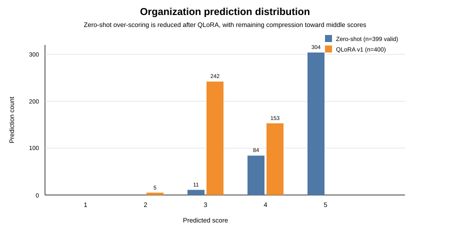

# Qwen3-4B + QLoRA for Korean Argumentative Essay Scoring

[한국어 README](README.ko.md)

My entry for the writing-scoring task in the 2026 AI말평 evaluation run by the National Institute of Korean Language (NIKL). The model reads a writing prompt and a Korean argumentative essay, scores it from 1 to 5 on content, organization and expression, and writes a short Korean rationale for each score.

I fine-tuned Qwen3-4B-Instruct with QLoRA, using a loss that puts most of its weight on the score tokens. On the hidden official test set it scored RMSE 0.621 and Spearman 0.570.

- Base model: `Qwen/Qwen3-4B-Instruct-2507`
- Fine-tuning: 4-bit NF4 QLoRA
- Hugging Face: https://huggingface.co/slvrfivo/qwen3-4b-writing-eval-v1-merged

## Results

| Model / Evaluation | RMSE ↓ | Spearman ↑ | Notes |
|---|---:|---:|---|
| Statistical mean baseline | 0.7870 | undefined* | Same score for every essay after rounding |
| Qwen3-4B zero-shot | 1.1612 | 0.2753 | 399 / 400 valid predictions |
| **Weighted QLoRA v1** | 0.6384 | 0.5237 | Selected checkpoint |
| Class-balanced QLoRA v1b | 0.6452 | 0.5189 | Ablation, not used |
| Official hidden test (v1) | 0.6213 | 0.5697 | LLM Judge 3.0337 |

\*After the official rounding, the mean baseline predicts the same score for every essay, so Spearman is undefined.

The submission placed 49th of 53 teams on the preliminary leaderboard. The top 50 moved on to the AI말평 Arena, where human experts compared model outputs; this model got 842 points and finished 44th of 50.

The test RMSE came out slightly better than validation (0.621 vs 0.638). The splits and evaluation conditions differ, so I don't read much into that.

Final results: [reports/final_results.md](reports/final_results.md) · Experiment log: [reports/experiments.md](reports/experiments.md)

## Task

The output is a single JSON object with a score and a rationale for each dimension:

~~~json
{
  "content": {
    "score": 4,
    "rationale": "주장과 근거가 주제에 맞게 제시되어 있으나 일부 근거의 구체성이 부족하다."
  },
  "organization": {
    "score": 3,
    "rationale": "전체적인 구조는 갖추고 있지만 문단 간 연결이 다소 자연스럽지 않다."
  },
  "expression": {
    "score": 4,
    "rationale": "대체로 적절한 어휘와 문장을 사용했으나 일부 표현이 반복된다."
  }
}
~~~

## Approach

### 1. Reproduce the official evaluator

Before training anything, I wrote `src/evaluate.py` to match the competition's scoring so that local numbers would be comparable. It:

- checks the JSON structure and that scores are within 1–5
- rounds with `ROUND_HALF_UP` before scoring
- computes RMSE and Spearman for each dimension
- uses average ranks for ties

### 2. Zero-shot baseline

I ran `Qwen/Qwen3-4B-Instruct-2507` in NF4 4-bit with greedy decoding and the official prompt. It got RMSE 1.161 and Spearman 0.275, and produced valid JSON for 399 of 400 essays.

It gave almost every essay a high score. For organization it gave a 5 to 304 of 399 essays, so fine-tuning was the obvious next step.

### 3. QLoRA fine-tuning

The training machine was an A100 MIG slice with about 9.5 GiB of VRAM, which ruled out full fine-tuning. The selected run used:

- NF4 4-bit base model, BF16 compute
- LoRA on all linear layers, `r=16`, `alpha=32`, `dropout=0.05`
- 1 epoch, learning rate `5e-5`, effective batch size 8
- max sequence length 2048

Full config: [configs/qwen3_4b_qlora_v1.json](configs/qwen3_4b_qlora_v1.json)

### Organization prediction distribution

After fine-tuning, organization predictions moved mostly to 3 and 4 (242 and 153 of 400). The over-scoring is largely gone, but predictions now bunch up in the middle.

## Weighted token loss

The competition only scores the numbers, but a standard language-model loss treats every output token about the same. So I tagged each target token by role and gave each role its own weight:

| Token role | Loss weight |
|---|---:|
| Prompt | 0.00 |
| JSON structure | 0.25 |
| Score | 10.00 |
| Rationale | 0.05 |

~~~text
weighted loss = Σ(token loss × token weight) / Σ(token weight)
~~~

I picked these weights by hand for this task. There was no hyperparameter search.

- `src/qlora/tokenization.py`: maps tokens to roles
- `src/qlora/loss.py`: weighted causal cross entropy
- `src/qlora/training.py`: plugs the loss into the Transformers Trainer

I never trained a QLoRA model with uniform loss, so I can't say how much of the improvement comes from the weighting and how much from fine-tuning in general.

## Ablation: class-balanced score weights

v1 still bunched its predictions around 3 and 4, so for v1b I also weighted score tokens by how rare each label is in the training set.

| Model | RMSE ↓ | Spearman ↑ |
|---|---:|---:|
| Weighted QLoRA v1 | 0.6384 | 0.5237 |
| Class-balanced QLoRA v1b | 0.6452 | 0.5189 |

v1b predicted more 1s and 5s, but both metrics got slightly worse, so I kept v1.

## Postmortem: scores vs rationales

Weighting score tokens at 10.0 and rationale tokens at 0.05, with template-style rationale targets, probably hurt the rationales. They got noticeably simpler after fine-tuning (noted in the experiment log). The LLM Judge score (3.03) and the Arena result, where experts also read the rationales, fit that explanation, but I didn't run anything that isolates the cause.

If I did it again, I would:

- run a uniform-loss baseline and sweep the rationale weight
- use richer rationale targets
- try two stages: one model predicts the scores, a second writes explanations given those scores
- use a rationale-quality metric in model selection, not just RMSE and Spearman

## Export and serving

I merged the adapter into the pinned BF16 base model and exported it as a standalone Hugging Face model. The export script runs merge → reload → model/tokenizer invariant check → strict-JSON smoke test.

In final submission testing, a few generations from the merged model got stuck repeating themselves, so the published model sets `"repetition_penalty": 1.05` in `generation_config.json`. The value is kept in [configs/submission_generation.json](configs/submission_generation.json), and the export CLI writes it into the exported config before the smoke test.

I also served the final model with vLLM's OpenAI-compatible server and checked the health, model-list and chat-completions endpoints the competition required. A draft model card is in [docs/huggingface_model_card.md](docs/huggingface_model_card.md).

## Reproduction

Environment details: [docs/reproducibility.md](docs/reproducibility.md)

~~~bash
pip install -r requirements-train-gpu.txt

# Train the selected QLoRA config
python src/train_qlora.py \
  --input data/raw/train.jsonl \
  --output-dir checkpoints/qwen3_4b_qlora_v1 \
  --config configs/qwen3_4b_qlora_v1.json

# Run validation inference with the adapter
python src/zero_shot.py \
  --input data/raw/validation.jsonl \
  --output-dir outputs/qlora_v1 \
  --adapter checkpoints/qwen3_4b_qlora_v1/final_adapter

# Evaluate
python src/evaluate.py \
  --predictions outputs/qlora_v1/predictions.jsonl \
  --require-rationale

# Merge into standalone BF16 weights
python src/export_merged_hf.py \
  --adapter checkpoints/qwen3_4b_qlora_v1/final_adapter \
  --output-dir /path/to/submission/qwen3-4b-writing-eval-v1-merged \
  --validation-input data/raw/validation.jsonl
~~~

## Tests

GitHub Actions runs the 85 CPU unit tests on every pull request and every push to `master`.

~~~bash
python -m unittest discover -s tests -v
~~~

## Repository layout

~~~text
ai-writing-eval/
├── configs/        # zero-shot, QLoRA, and final serving configs
├── docs/           # competition and reproducibility notes
├── prompts/        # versioned official prompt
├── reports/        # experiment log and official results
├── src/
│   ├── llm/        # prompting, parsing, inference, export
│   └── qlora/      # QLoRA data, tokenization, loss, training
├── tests/
├── requirements*.txt
├── LICENSE
└── README.md
~~~

## Limitations

- The training set is only 2,000 essays.
- v1 still pulls predictions toward the middle; 1s and 5s are harder to get right than 3s and 4s.
- Without a uniform-loss run, the effect of the weighted loss on its own is unknown.
- The local evaluator reproduces RMSE and Spearman but not the official LLM Judge.
- I haven't tested the model outside the competition's prompts, domain and rubric.

## Data and license

Competition data is not included in this repository. Data, checkpoints, generated outputs and model weights are excluded via `.gitignore`.

The code is released under the Apache License 2.0. Third-party models, competition data and official materials are subject to their own terms.

## Official references

- Task overview: https://kli.korean.go.kr/benchmark/taskOrdtm/taskList.do?taskOrdtmId=205
- Preliminary leaderboard: https://kli.korean.go.kr/benchmark/taskOrdtm/taskLeaderBoard.do?clCd=ING_TASK&subMenuId=sub04&taskOrdtmId=205
- Arena overview: https://kli.korean.go.kr/taskOrdtm/taskList.do?clCd=END_TASK&subMenuId=sub01&taskOrdtmId=215
